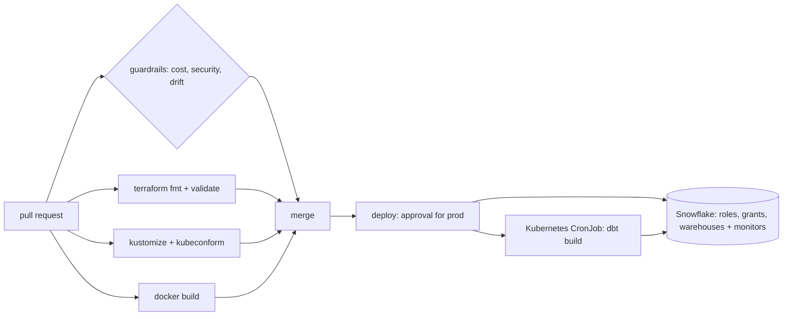

# Platform as Code

[](https://github.com/Saigwe/platform-as-code/actions/workflows/ci.yml)
  

> **Headline:** production Snowflake spend is **capped at $2,010 a month in code** (dev at $360). Every warehouse, role, grant and scheduled dbt job is reviewed like any other change, and a risky change, such as an XLARGE warehouse in dev, is **blocked before it merges**.

The analytics platform, defined in a repository: **Terraform** for Snowflake (database, schemas, functional roles, grants, warehouses and resource monitors), a **Docker** image that runs dbt, and **Kubernetes** CronJobs with Kustomize overlays for dev and prod. A **policy-as-code** layer in Python checks every pull request against cost, security and consistency rules. It applies the lessons from [warehouse-finops](https://github.com/Saigwe/warehouse-finops) as defaults that can't be skipped: 60-second auto-suspend, right-sized warehouses and a hard cap on every warehouse.



## What's in it

| Layer | Files | Highlights |
|---|---|---|
| **Snowflake (Terraform)** | `terraform/`, `terraform/modules/warehouse/` | Warehouses can only be created through a module that always attaches a resource monitor (alert at 75% and 90%, suspend at 100%). Validation rejects sizes above LARGE and auto-suspend above 10 minutes. Functional roles are rolled up to SYSADMIN, and Terraform never runs as ACCOUNTADMIN |
| **Environments** | `terraform/envs/dev.tfvars`, `prod.tfvars` | The same code for both environments, with different sizes, caps and Time Travel retention |
| **dbt runner (Docker)** | `docker/Dockerfile`, `dbt/` | Pinned base image and dependencies, non-root user, profiles read from the environment, so the image holds no secrets |
| **Scheduling (Kubernetes)** | `k8s/base`, `k8s/overlays/{dev,prod}` | CronJob with `concurrencyPolicy: Forbid`, a run deadline, CPU and memory limits, a read-only root filesystem and dropped capabilities. Dev runs on weekday mornings; prod runs hourly with more resources |
| **Guardrails (Python)** | `policy/` | Cost: size limits per environment, auto-suspend, a total budget per environment. Security: no privileged roles, no root containers, pinned images. Drift: the warehouse and role in each Kubernetes ConfigMap must exist in that environment's Terraform |
| **CI/CD** | `.github/workflows/` | `ci.yml` runs guardrails, `terraform fmt`/`validate`, kubeconform on the rendered overlays and a Docker build on every push. `deploy.yml` plans, applies, pushes the image and applies the manifests, gated by a GitHub Environment approval for prod |

The guardrail report is [`output/platform_report.md`](output/platform_report.md). It lists the spending caps per environment, the result of every check, and exactly why the sample risky change in [`tests/fixtures/risky.tfvars`](tests/fixtures/risky.tfvars) is rejected.

## Run it

```bash
pip install -r requirements.txt
python -m policy.check                      # guardrails + report (exit code 1 on any violation)
pytest

# with the tools installed:
terraform -chdir=terraform init -backend=false && terraform -chdir=terraform validate
kubectl kustomize k8s/overlays/prod
docker build -f docker/Dockerfile -t dbt-runner .
```

Deploying for real needs a Snowflake account, a `TERRAFORM_ADMIN` role with key-pair auth, a state bucket and a cluster. `deploy.yml` lists the secrets it expects. Everything else validates without any of them.

## Walkthrough

- [ ] 3-minute Loom walkthrough ([script ready](docs/walkthrough.md))

## Stack

Terraform (Snowflake provider), Docker, Kubernetes, Kustomize, kubeconform, GitHub Actions, dbt, Python (python-hcl2, PyYAML), pytest.
